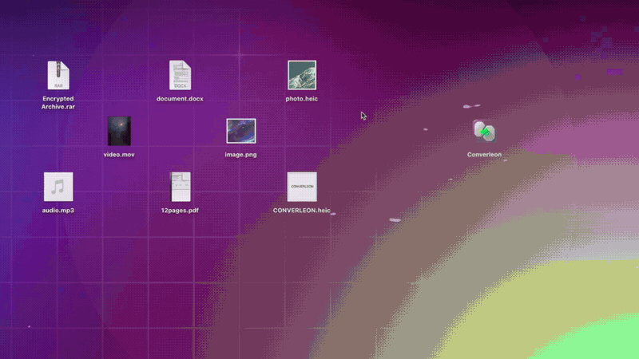
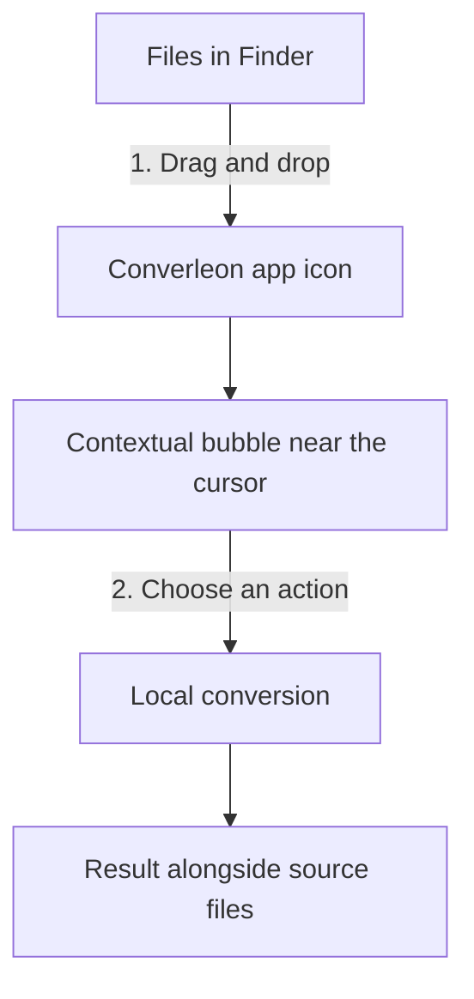
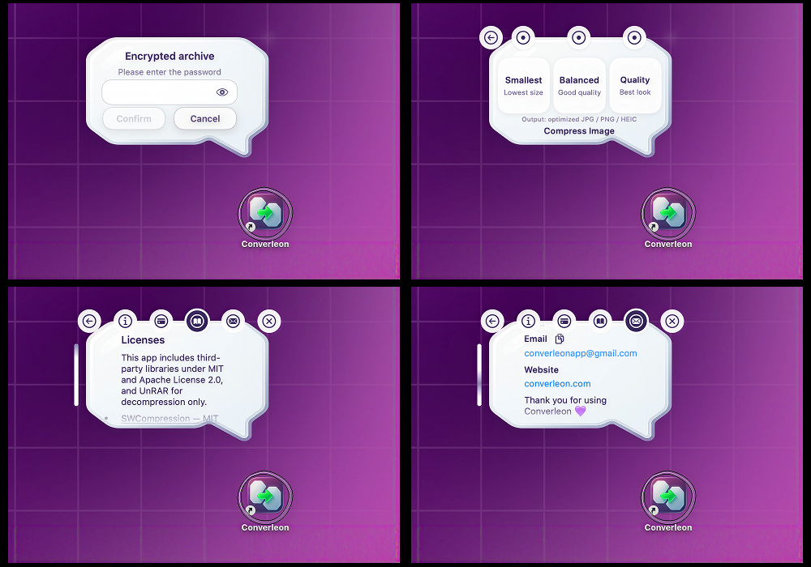
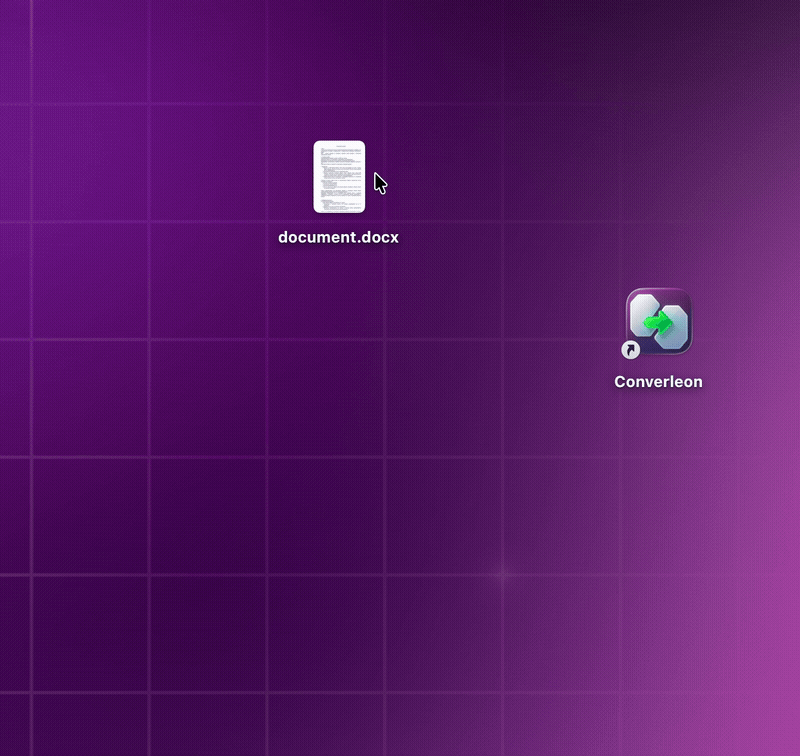
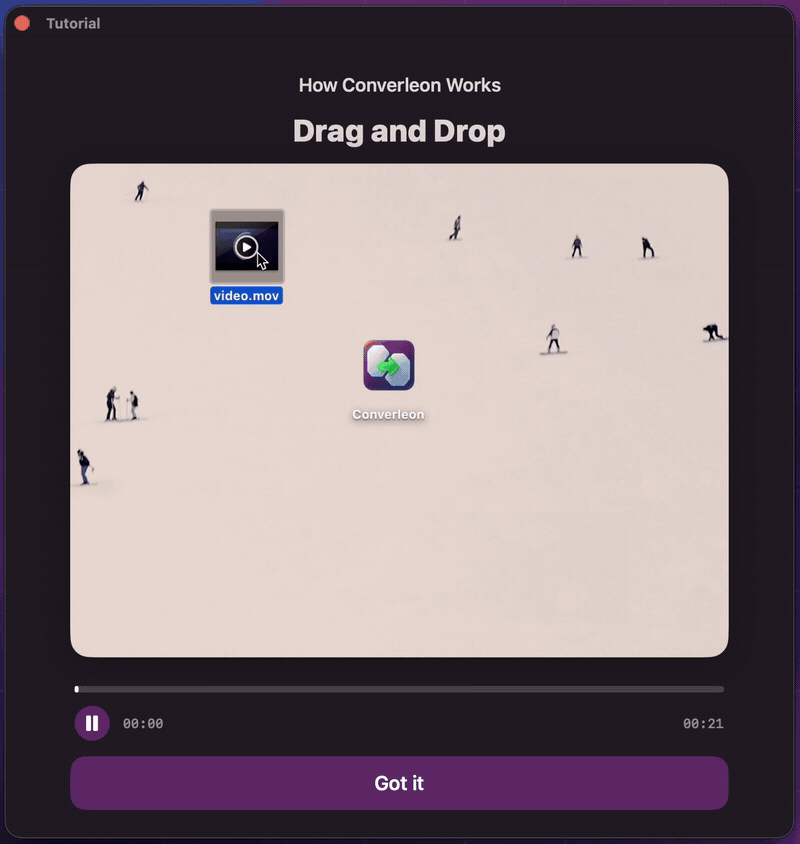
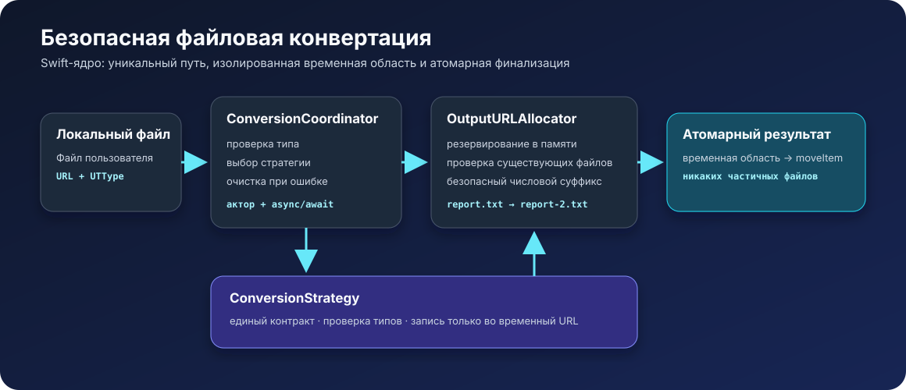
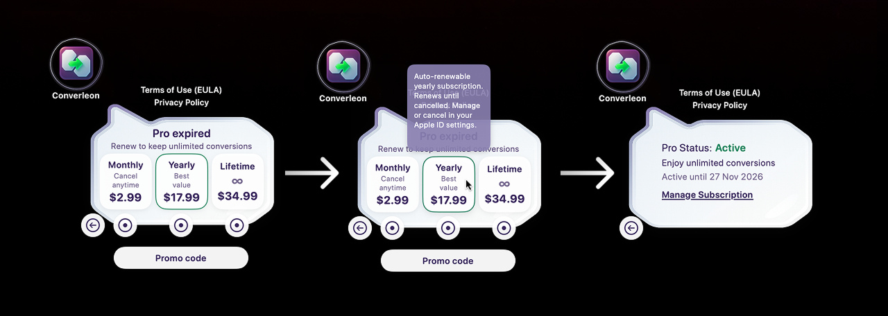

[🇬🇧 English](README.md) | [🇷🇺 Русский](README.ru.md)

# Converleon — Offline File Conversion in Two Steps on macOS

Converleon is an offline macOS file converter available on the Mac App Store. It handles images, video, audio, documents, PDFs, and archives, including batches of mixed file types. The app opens a compact bubble near the drop point.

**Product:** [Converleon website](https://www.converleon.com/) · [Mac App Store](https://apps.apple.com/app/converleon/id6751464821)

> **Public engineering showcase.** This repository contains the standalone Swift core of a commercial macOS app released on the App Store. The full product also includes proprietary format-specific converters, a SwiftUI and AppKit bubble interface, App Sandbox integration, StoreKit, onboarding, 18 localizations, and an update release process.

The demo shows conversion for common file types: images, video, audio, documents, and archives. The current version also supports image enhancement, background removal, compression, and additional formats.

<p align="center">
  <a href="docs/assets/conversion-demo.gif">
    
  </a>
</p>
<p align="center"><sub>The same interaction works for multiple file types and saves each result alongside its source. Click to enlarge.</sub></p>

## Product

Converleon brings common file operations into a single local app:

- Converts mixed batches of images, video, audio, documents, PDFs, and archives.
- Compresses media, extracts audio, enhances images, and removes backgrounds.
- Merges and splits PDFs and creates multipage documents.
- Extracts common archive formats and packages files and folders into ZIP archives.
- Processes files entirely on the Mac, with no uploads to a conversion server.
- Saves results alongside their source files and preserves the originals.

The app is available in all Mac App Store countries and regions. Its product page and screenshots are localized into 18 languages. StoreKit 2 powers in-app purchases, including a seven-day trial with full access, monthly and yearly subscriptions, and a lifetime purchase.

<p align="center">
  <a href="docs/assets/app-store-localizations.png">
    
  </a>
</p>
<p align="center"><sub>Japanese and Arabic localizations of the Converleon listing in App Store Connect.</sub></p>

## Core interface design: a single contextual bubble

Converleon's working interface is a transparent, borderless `NSPanel` that appears near the drop point. Users stay in Finder and see only the actions available for their selected files.



The same bubble switches between views and states:

- Output formats.
- Compression options.
- Password entry for protected archives.
- Subscription and checkout.
- Help, licenses, and support.
- Conversion details and typed errors.

<p align="center">
  <a href="docs/assets/bubble-states.png">
    
  </a>
</p>
<p align="center"><sub>One bubble contains format selection, help, subscriptions, and operational states.</sub></p>

The bubble stays anchored to the user's action and remains fully visible wherever the app icon is positioned. The algorithm automatically chooses one of four placements above or below and to the left or right of the drop point. The bubble expands into available space within the screen bounds. A separate animation at the same point shows progress and a completion checkmark.

### The chameleon mascot in the format grid

Output format buttons are arranged in two columns. When the number of available actions is odd, the final row has an empty cell. Converleon fills that space with its chameleon mascot, drawn without a frame or separate button so it feels like part of the bubble.

The chameleon's eyes follow the cursor across the screen. On click, it disappears into the background and can return when the bubble enters another eligible state.

The name connects function to branding: a chameleon changes color, and Converleon changes file formats. The mascot:

- Fills the gap in an odd-numbered format grid.
- Adds movement to the minimalist interface.
- Provides a subtle interactive Easter egg.
- Illustrates the name **Converleon = converter + chameleon** without words.

The grid layout thus becomes part of the product's visual identity.

<p align="center">
  <a href="docs/assets/chameleon.gif">
    
  </a>
</p>

## Two mouse actions

The primary workflow takes two steps:

1. Drag one or more files onto the Converleon app icon.
2. Choose a format or action in the bubble.

Converleon also supports Open With, system file-opening events, `File → Convert Files…`, and `⌘O`. For batches with mixed file types, the bubble shows only applicable actions and removes the need for separate input and output format selection screens.

## Onboarding for the interaction model

Conversion starts directly from the files. Drag them onto the app icon, then select an operation in the contextual bubble. Users stay in Finder, and the result appears alongside the source files without a separate save dialog.

The main workflow removes intermediate screens and clicks from repeated conversions. Launching Converleon directly opens a separate floating window with a short looping video to introduce or recap the controls. It shows drag and drop, Open With, and how to add Converleon to the Finder toolbar.

<p align="center">
  <a href="docs/assets/tutorial.gif">
    
  </a>
</p>
<p align="center"><sub>The tutorial introduces the app's interaction model when launched directly.</sub></p>

When Converleon receives one or more files through a drop on the app icon, Open With, or another system open event, it opens the bubble directly with available actions and skips the tutorial. Drag and drop is the primary workflow. Open With provides another system entry point.

The tutorial uses `SwiftUI`, `AVQueuePlayer`, and `AVPlayerLooper` inside a separate `NSWindow`.

## Role and scope

My work covered the product concept, UX and design, app and conversion architecture, testing, preparation of 18 localizations, and release on the App Store.

Main responsibilities:

- Two-step workflow and a spatially anchored bubble with adaptive positioning.
- Chameleon mascot combining grid layout, microinteraction, and brand identity.
- SwiftUI and AppKit window lifecycle.
- Conversion pipeline for multiple file classes.
- App Sandbox and least-privilege file access.
- StoreKit 2, the trial, subscriptions, and the lifetime purchase.
- Clear error states and predictable output placement.
- App Store release, ASO assets, and 18 localizations.

## How the interface works



### SwiftUI + AppKit

SwiftUI handles views. AppKit manages the window lifecycle, `NSPanel`, `NSWindow`, `NSHostingView`, activation, and focus. System mouse tracking captures the drop point and lets the chameleon follow the cursor across the screen.

The app uses the drop point both to anchor the interface and to choose its placement. The algorithm calculates the distance to the diagonals of the visible screen area, determines which direction has the most room, and selects one of four `KeyPanel` configurations above or below and to the left or right of the icon. The borderless panel expands in the selected direction so it stays fully visible even near an edge or corner. It takes keyboard focus when needed.

### Safe file access in App Sandbox

The app uses the `user-selected.read-write` entitlement and security-scoped bookmarks. If permissions are insufficient, the user selects the source folder through `NSOpenPanel`. Converleon accesses only the location it needs and saves the result alongside the source file.

### StoreKit in the same interface

The bubble hosts StoreKit for the `Monthly`, `Yearly`, and `Lifetime` plans, purchase restoration, promo codes, and subscription management. These actions use the same window and visual language as the rest of the interface.

<p align="center">
  <a href="docs/assets/subscription-bubble.png">
    
  </a>
</p>

## What this repository demonstrates

The repository shows the conversion core and the transactional lifecycle of a file operation:

1. Detect the input file type.
2. Determine valid output formats from the detected type and strategy registry.
3. Select an implementation through `ConversionStrategy`.
4. Reserve a unique output URL.
5. Write to a temporary location.
6. Atomically move the finished file into place.
7. Clean up temporary artifacts.
8. Return a typed result or error to the caller.

The code demonstrates:

- The `Strategy` pattern, with each converter conforming to the `ConversionStrategy` protocol.
- Centralized type detection using `UTType` conformance.
- Available actions derived directly from strategy capabilities.
- Output name reservation in a dedicated actor.
- Protection against overwrites and concurrent conflicts.
- A staging location on the same filesystem volume.
- Asynchronous coordination through structured concurrency and actor isolation.
- Batch processing with bounded concurrency, preserved input order, and per-file failure isolation.
- Centralized cleanup on failure and `CancellationError`.
- Detection of external conflicts between reservation and commit without overwriting another file.
- XCTest coverage for successful conversion, cancellation, typed errors, atomicity, and concurrent execution.

## Design decisions

### Strategies make the pipeline extensible

Each format implements `ConversionStrategy` and declares the types it supports. A new converter can be added without modifying `ConversionCoordinator` or expanding conditional logic.

### Centralize file type detection

`FileTypeDetector` handles known extensions and then uses the system's `UTType` and its conformance graph. The coordinator receives an explicit, typed result.

### Reserve output names before conversion

`OutputURLAllocator` is an actor. Concurrent jobs receive distinct output paths even before their final files exist. The allocator releases reservations after success, failure, or cancellation.

### Expose only finished files

The strategy writes to a staging file in the destination directory so it can commit with an atomic `moveItem` on the same volume. Before committing, the coordinator checks the reserved URL again. If an external process has claimed it, the pipeline preserves that file, removes the staging file, and returns a typed error.

## Public core architecture

```text
input URL
   │
   ▼
FileTypeDetector ──► ConversionCoordinator ──► ConversionStrategy
                            │                         │
                            ▼                         ▼
                    OutputURLAllocator          staging file
                            │                         │
                            └────── atomic move ◄───────┘
```

## Where to start reading the code

1. [ConversionStrategy.swift](Sources/ConversionCore/ConversionStrategy.swift) — contract for extending the conversion pipeline.
2. [ConversionCoordinator.swift](Sources/ConversionCore/ConversionCoordinator.swift) — operation lifecycle.
3. [BatchConversion.swift](Sources/ConversionCore/BatchConversion.swift) — bounded concurrency and per-item batch results.
4. [OutputURLAllocator.swift](Sources/ConversionCore/OutputURLAllocator.swift) — concurrent output name reservation.
5. [FileTypeDetector.swift](Sources/ConversionCore/FileTypeDetector.swift) — centralized file type detection.
6. [ConversionCoordinatorTests.swift](Tests/ConversionCoreTests/ConversionCoordinatorTests.swift) — atomicity, cancellation, external conflicts, and concurrent execution.

## Minimal runnable example

Requires macOS 13+ and Swift 6.0+.

```bash
swift run conversion-demo
```

The CLI runs a file conversion end to end so you can verify that the package builds and exercise the conversion lifecycle and core library invariants.

## Tests and checks

```bash
swift build
swift format lint --configuration .swift-format --recursive Sources Tests Package.swift
bash scripts/check-coverage.sh
bash scripts/check.sh
```

`check-coverage.sh` runs instrumented tests and requires at least 85% line coverage for the core library. GitHub Actions runs the full suite on macOS.

## Scope of the public implementation

The public repository focuses on the conversion core and file operations that require safe, predictable results. The full App Store version adds specialized macOS strategies, the bubble interface, sandbox permissions, StoreKit, and an update release process.

## Author

**Natali Antro — AI Product Engineer, creator, and sole developer of the product.**
