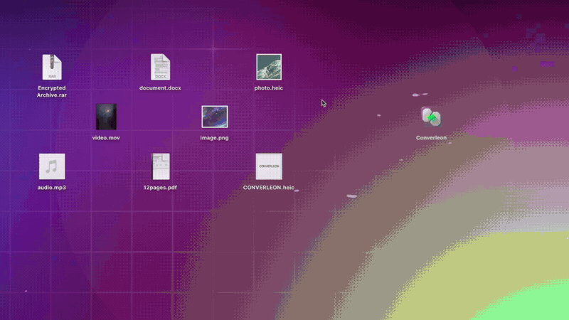
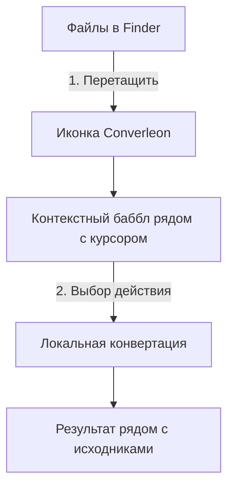
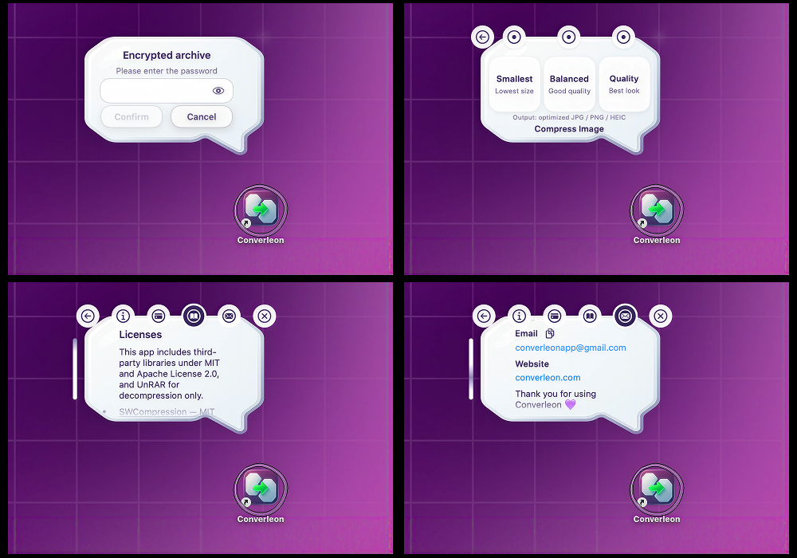
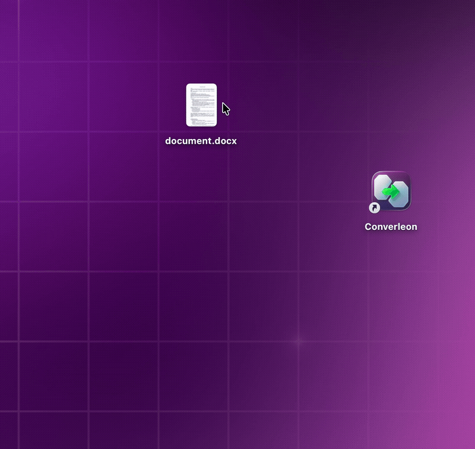
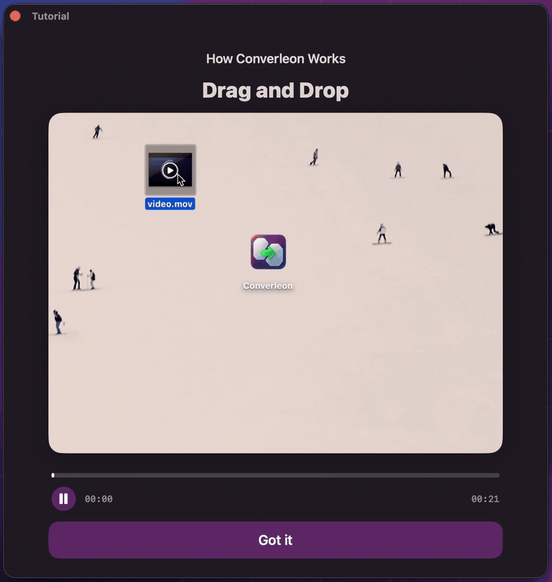
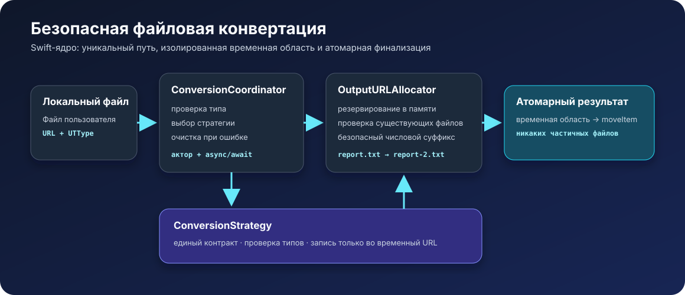
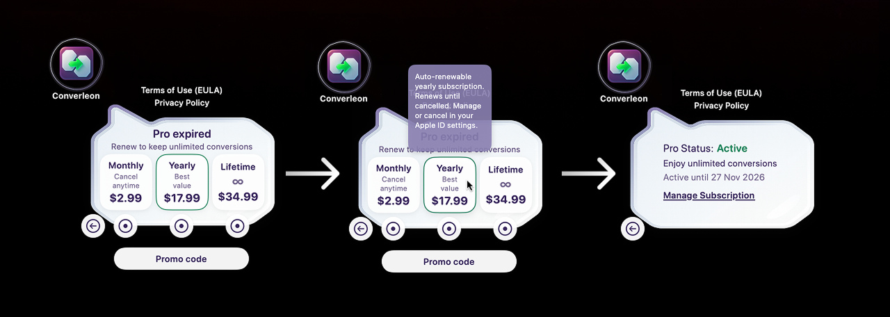

[🇬🇧 English](README.md) | [🇷🇺 Русский](README.ru.md)

# Converleon — офлайн-конвертация файлов за два действия в macOS

Converleon — офлайн-конвертер для macOS, выпущенный в Mac App Store. Он работает с изображениями, видео, аудио, документами, PDF и архивами, в том числе когда пользователь передаёт несколько файлов разных типов одновременно. Вместо обычного окна приложение показывает компактный баббл рядом с местом, куда были перетащены файлы.

**Продукт:** [сайт Converleon](https://www.converleon.com/) · [Mac App Store](https://apps.apple.com/app/converleon/id6751464821)

> **Публичный engineering showcase.** Репозиторий содержит самостоятельно запускаемое Swift-ядро реального коммерческого macOS-приложения, выпущенного в App Store. Полный продукт также включает специализированные конвертеры, баббл-интерфейс на SwiftUI и AppKit, App Sandbox, StoreKit, onboarding, 18 локализаций и систему выпуска обновлений, которые не публикуются.

Демонстрация показывает работу с основными типами файлов: изображениями, видео, аудио, документами и архивами. Актуальная версия также поддерживает улучшение изображений, удаление фона, сжатие и дополнительные форматы.

<p align="center">
  <a href="docs/assets/conversion-demo.gif">
    
  </a>
</p>
<p align="center"><sub>Несколько типов файлов, один способ взаимодействия и результат рядом с исходником. Нажмите, чтобы увеличить.</sub></p>

## Продукт

Converleon объединяет повседневные задачи с файлами в одном локальном приложении:

- конвертирует смешанные наборы изображений, видео, аудио, документов, PDF и архивов;
- сжимает медиафайлы, извлекает аудио, улучшает изображения и удаляет фон;
- объединяет и разделяет PDF, создаёт многостраничные документы;
- распаковывает распространённые форматы архивов и упаковывает любые файлы и папки в ZIP;
- выполняет операции полностью локально — файлы не загружаются на сервер конвертации;
- сохраняет результат рядом с исходниками, оставляя оригиналы неизменными.

Приложение доступно во всех странах Mac App Store. Страница продукта и снимки экрана локализованы на 18 языков. Встроенные покупки работают на StoreKit 2: пользователю доступны семидневный пробный период со всеми функциями, месячная и годовая подписки, а также бессрочная покупка.

<p align="center">
  <a href="docs/assets/app-store-localizations.png">
    
  </a>
</p>
<p align="center"><sub>Страница Converleon в App Store Connect на примере японской и арабской локализаций.</sub></p>

## Главное решение интерфейса: один баббл вместо главного окна

Рабочий интерфейс Converleon — прозрачная безрамочная панель `NSPanel`, которая появляется рядом с точкой перетаскивания. Пользователь остаётся в контексте Finder и видит только действия, доступные для выбранных файлов.



Один визуальный объект переключается между режимами:

- форматы;
- варианты сжатия;
- запрос пароля для защищённых архивов;
- подписка и экран оплаты;
- справка, лицензии и поддержка;
- сведения о конвертации и типизированные ошибки.

<p align="center">
  <a href="docs/assets/bubble-states.png">
    
  </a>
</p>
<p align="center"><sub>Один баббл объединяет выбор формата, справку, подписку и рабочие состояния.</sub></p>

Баббл сохраняет пространственную связь с исходным действием и при этом остаётся полностью видимым при любом положении иконки приложения. Алгоритм автоматически выбирает один из четырёх вариантов панели: выше или ниже, левее или правее точки перетаскивания. Баббл раскрывается в сторону свободной области, не уходя за границы экрана. Ход операции и финальная галочка отображаются отдельной анимацией в той же точке.

### Хамелеон: ограничение сетки становится характером продукта

Кнопки выходных форматов расположены в два столбца. Когда доступных действий нечётное количество, в последней строке остаётся пустая ячейка. Converleon превращает её в узнаваемую деталь интерфейса: свободное место занимает хамелеон — талисман продукта. У него нет рамки или отдельной кнопки, словно он просто поселился внутри баббла.

Его глаза следят за курсором по всему экрану. При клике хамелеон исчезает, визуально сливаясь с фоном, а при следующем подходящем состоянии баббла может появиться снова.

Название связывает функцию приложения с образом бренда: хамелеон меняет окраску, а Converleon — формат файла. Эта деталь одновременно:

- балансирует нечётную сетку форматов;
- оживляет минималистичный интерфейс;
- добавляет ненавязчивую интерактивную пасхалку;
- без слов раскрывает название **Converleon = converter + chameleon**.

Так особенность сетки становится не компромиссом, а частью визуального языка и характера продукта.

<p align="center">
  <a href="docs/assets/chameleon.gif">
    
  </a>
</p>

## Два действия мышью

Основной повторяемый сценарий:

1. Перетащить один или несколько файлов на иконку приложения Converleon.
2. Выбрать в появившемся баббле формат или действие.

Также поддерживаются команда Open With («Открыть с помощью»), системное открытие файла приложением, `File → Convert Files…` и `⌘O`. Для набора файлов разных типов баббл показывает только подходящие действия, поэтому пользователю не приходится проходить отдельные экраны выбора исходного и выходного форматов.

## Знакомство с нестандартной моделью взаимодействия

Converleon не требует предварительно открывать приложение, выбирать файлы в главном окне и отдельно задавать место сохранения. Рабочий сценарий начинается непосредственно с файлов и сокращается до двух действий: перетаскивания на иконку и выбора операции в контекстном баббле. Пользователь остаётся в Finder, а результат появляется рядом с исходниками.

Отказ от обычного главного окна — основа продуктовой концепции, а не только визуальное решение. Такое устройство убирает промежуточные экраны и клики из повторяемого сценария конвертации. При обычном запуске Converleon открывается отдельное плавающее окно с коротким зацикленным видео: пользователь может познакомиться с механикой или быстро освежить её в памяти. Видео показывает основной сценарий перетаскивания, команду Open With и добавление приложения на панель инструментов Finder.

<p align="center">
  <a href="docs/assets/tutorial.gif">
    
  </a>
</p>
<p align="center"><sub>Видео знакомит с нестандартной моделью взаимодействия при обычном запуске приложения.</sub></p>

Если приложение получает один или несколько файлов — при перетаскивании на иконку, через Open With или другое системное событие открытия, — обучающее видео не показывается. Converleon сразу открывает баббл с доступными действиями. Drag-and-drop остаётся основным сценарием, а Open With — дополнительным системным способом передать файл.

Окно обучения собрано на `SwiftUI`, `AVQueuePlayer` и `AVPlayerLooper` внутри отдельного `NSWindow`.

## Роль и объём работы

Работа над Converleon охватывала продуктовую концепцию, пользовательский опыт и дизайн, архитектуру приложения и системы конвертации, тестирование, подготовку 18 локализаций и выпуск в App Store.

Ключевые области ответственности:

- двухшаговая модель взаимодействия и пространственный баббл-интерфейс с адаптивным позиционированием;
- хамелеон-талисман как сочетание логики сетки, микровзаимодействия и образа бренда;
- жизненный цикл окон на SwiftUI и AppKit;
- конвейер конвертации для нескольких классов файлов;
- App Sandbox и минимально необходимый доступ к файлам;
- StoreKit 2, пробный период, подписки и бессрочная покупка;
- понятные состояния ошибок и предсказуемое сохранение результата;
- выпуск в App Store, материалы ASO и 18 локализаций.

## Как устроен простой интерфейс



### SwiftUI + AppKit

SwiftUI отвечает за представления, AppKit — за жизненный цикл окон, `NSPanel`, `NSWindow`, `NSHostingView`, активацию и фокус. Системное отслеживание мыши фиксирует точку отпускания файлов и позволяет хамелеону следить за курсором по всему экрану.

Координаты этой точки используются не только для привязки интерфейса к действию пользователя. Алгоритм рассчитывает расстояние до диагоналей видимой области экрана, определяет направление с наибольшим запасом пространства и выбирает одну из четырёх конфигураций `KeyPanel`: выше или ниже, левее или правее иконки. Панель без рамки раскрывается в выбранном направлении, поэтому баббл целиком остаётся на экране даже тогда, когда иконка Converleon находится у его края или в углу. При необходимости панель получает фокус клавиатуры.

### Безопасная работа в App Sandbox

Приложение использует разрешение `user-selected.read-write` и закладки ограниченного доступа. Если прав недостаточно, пользователь выбирает исходную папку через `NSOpenPanel`. Converleon получает доступ только к нужному расположению и сохраняет результат рядом с исходным файлом.

### StoreKit внутри единого языка интерфейса

StoreKit встроен в тот же баббл. Тарифы `Monthly`, `Yearly` и `Lifetime`, восстановление покупок, промокод и управление подпиской не требуют отдельного окна или другого языка интерфейса.

<p align="center">
  <a href="docs/assets/subscription-bubble.png">
    
  </a>
</p>

## Что показывает этот репозиторий

Репозиторий показывает архитектурное ядро конвертации и транзакционный жизненный цикл файловой операции:

1. определение типа входного файла;
2. получение допустимых форматов из определённого типа и реестра стратегий;
3. выбор реализации через `ConversionStrategy`;
4. резервирование уникального URL результата;
5. запись во временную область;
6. атомарное перемещение готового файла;
7. очистка временных артефактов;
8. возврат типизированного результата или ошибки вызывающему интерфейсу.

Код демонстрирует:

- паттерн `Strategy`: конвертеры реализуют единый протокол `ConversionStrategy`;
- централизованное определение типа через соответствие `UTType`;
- формирование списка доступных действий из возможностей стратегий, а не из отдельного списка в интерфейсе;
- резервирование имени результата в отдельном акторе;
- защиту от перезаписи и конкурентных конфликтов;
- временную область на том же томе файловой системы;
- управление асинхронным процессом через structured concurrency и actor isolation;
- пакетное выполнение с ограниченной конкурентностью, сохранением входного порядка и изоляцией ошибки отдельного файла;
- централизованную очистку при ошибке и `CancellationError`;
- обнаружение внешнего конфликта между reservation и commit без перезаписи чужого файла;
- XCTest для успешного сценария, отмены, типизированных ошибок, атомарности и конкурентного выполнения.

## Почему выбраны такие решения

### Стратегия масштабирует конвейер конвертации

Каждый формат реализует `ConversionStrategy` и объявляет поддерживаемые типы. Новый конвертер добавляется без изменения `ConversionCoordinator` и разрастания условной логики.

### Тип определяется централизованно

`FileTypeDetector` обрабатывает известные расширения, затем использует системный `UTType` и его граф соответствий. Координатор получает явный типизированный результат.

### Имя резервируется до начала работы

`OutputURLAllocator` реализован как actor. Параллельные задачи не получают одинаковый путь результата, даже пока итоговый файл ещё не создан; reservation освобождается и после успеха, и при ошибке или отмене.

### Пользователь видит только готовый результат

Стратегия пишет в staging-файл в целевой директории, поэтому commit выполняется атомарным `moveItem` на том же томе. Перед commit координатор повторно проверяет зарезервированный URL: если его занял внешний процесс, чужой файл сохраняется, staging удаляется, а вызывающий код получает typed error.

## Архитектура публичного ядра

```text
входной URL
   │
   ▼
FileTypeDetector ──► ConversionCoordinator ──► ConversionStrategy
                            │                         │
                            ▼                         ▼
                    OutputURLAllocator          временный файл
                            │                         │
                            └──── атомарный перенос ◄─┘
```

## С чего начать обзор кода

1. [ConversionStrategy.swift](Sources/ConversionCore/ConversionStrategy.swift) — контракт расширения конвейера конвертации.
2. [ConversionCoordinator.swift](Sources/ConversionCore/ConversionCoordinator.swift) — жизненный цикл операции.
3. [BatchConversion.swift](Sources/ConversionCore/BatchConversion.swift) — ограниченная конкурентность и результаты отдельных элементов пакета.
4. [OutputURLAllocator.swift](Sources/ConversionCore/OutputURLAllocator.swift) — конкурентное резервирование имён.
5. [FileTypeDetector.swift](Sources/ConversionCore/FileTypeDetector.swift) — централизованное определение типа.
6. [ConversionCoordinatorTests.swift](Tests/ConversionCoreTests/ConversionCoordinatorTests.swift) — атомарность, отмена, внешний конфликт и конкурентное выполнение.

## Минимальный исполняемый сценарий

Требуются macOS 13+ и Swift 6.0+.

```bash
swift run conversion-demo
```

CLI выполняет сквозной файловый сценарий и позволяет проверить собираемость пакета, жизненный цикл конвертации и основные инварианты библиотечного ядра.

## Тесты и проверки

```bash
swift build
swift format lint --configuration .swift-format --recursive Sources Tests Package.swift
bash scripts/check-coverage.sh
bash scripts/check.sh
```

`check-coverage.sh` запускает тесты с инструментированием и требует не менее 85% покрытия строк библиотечного ядра. GitHub Actions повторяет полный набор проверок на macOS.

## Публичный инженерный контур

Публичный репозиторий сосредоточен на ядре конвертации и файловых сценариях, в которых особенно важны безопасность и предсказуемость результата. Полная версия из App Store дополняет его специализированными стратегиями для macOS, баббл-интерфейсом, разрешениями песочницы, StoreKit и системой выпуска обновлений.

## Автор

**Натали Антро — AI Product Engineer, создатель и единственный разработчик продукта.**
